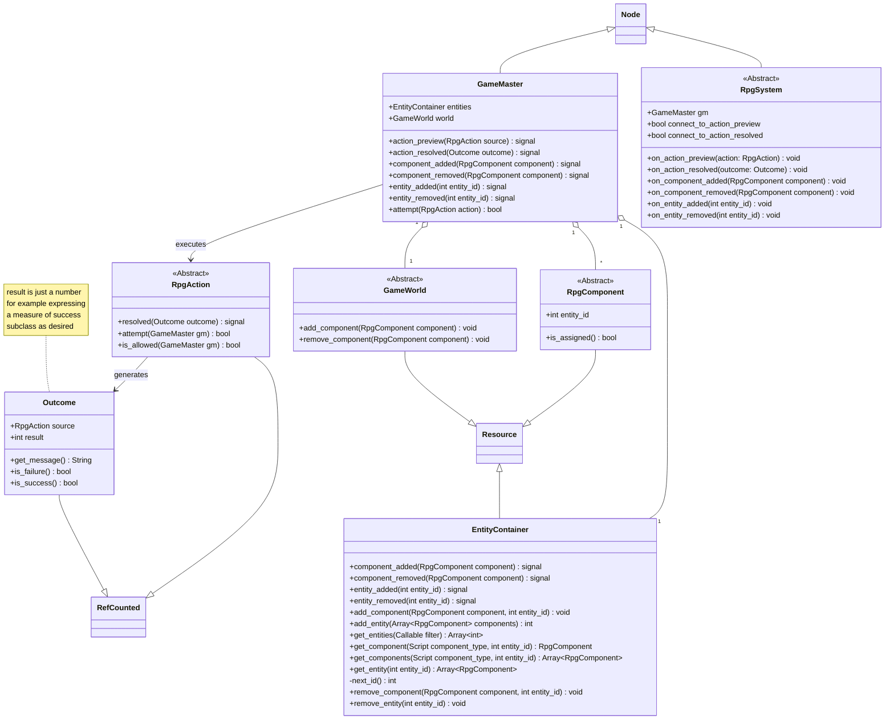
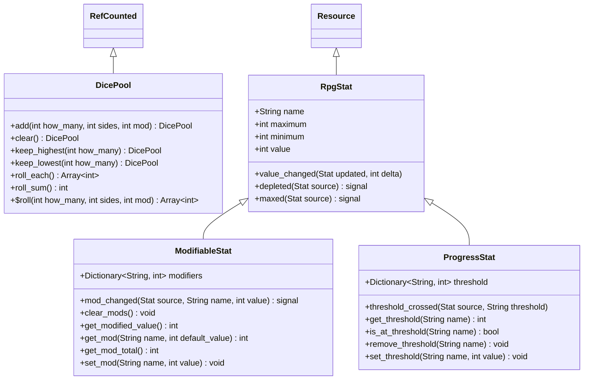
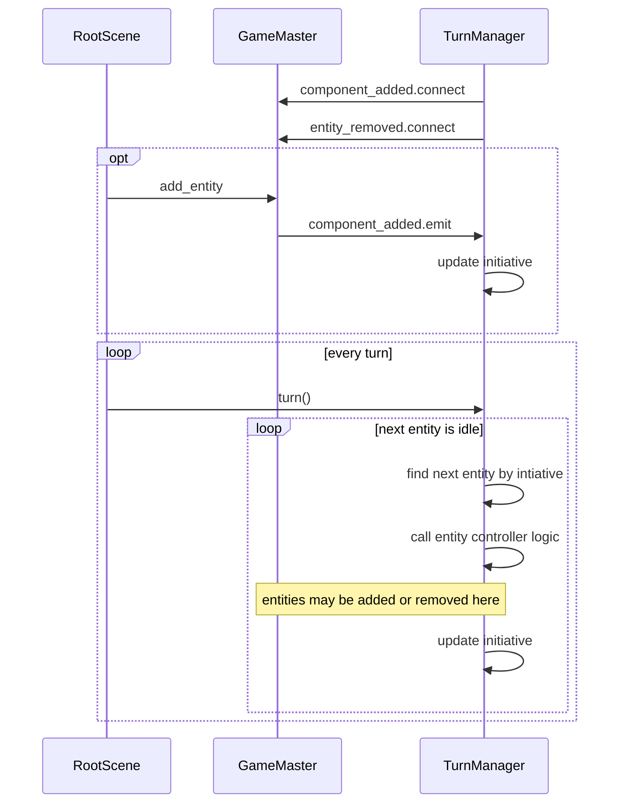
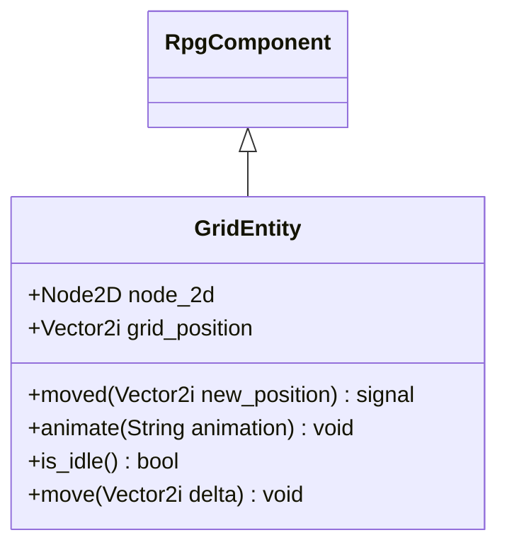
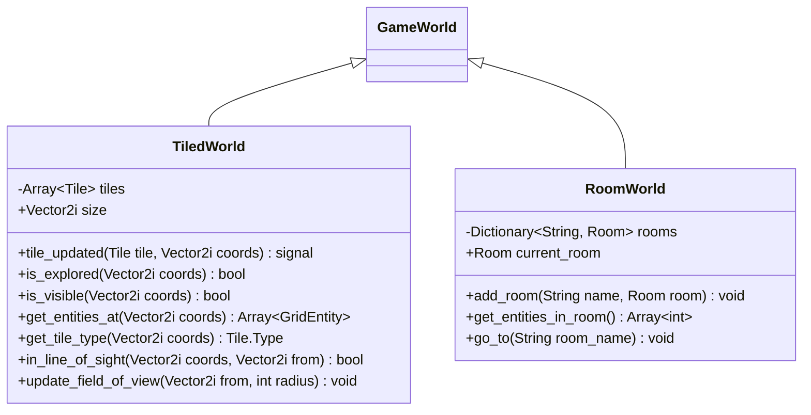
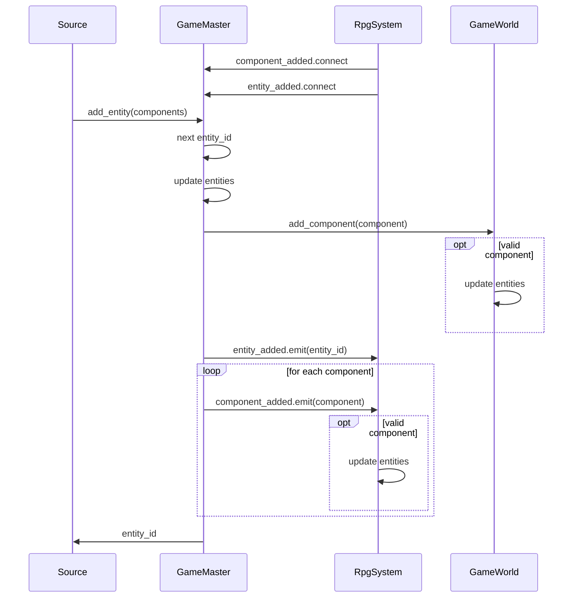
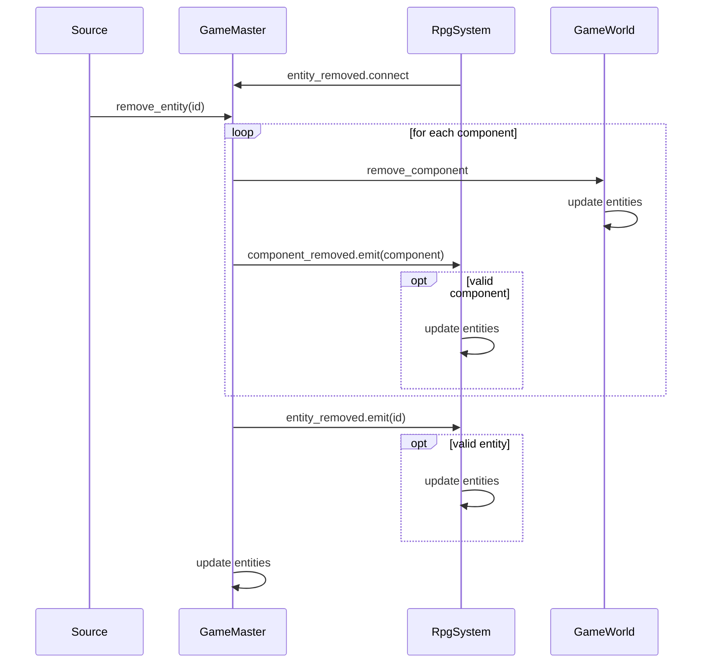
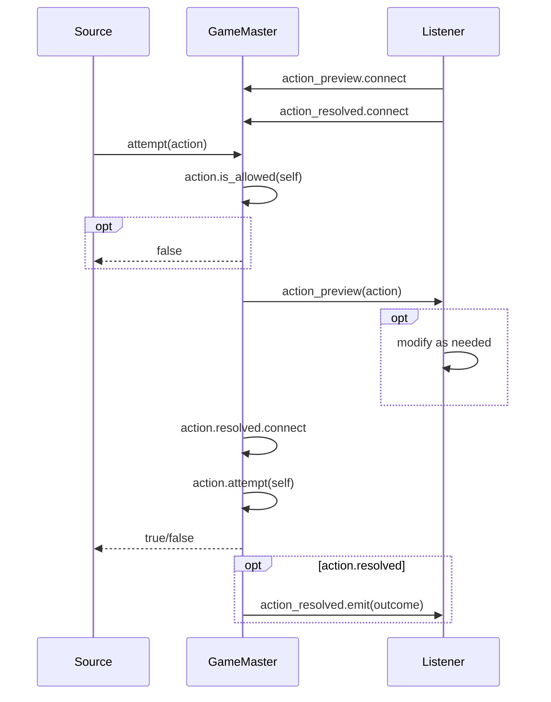
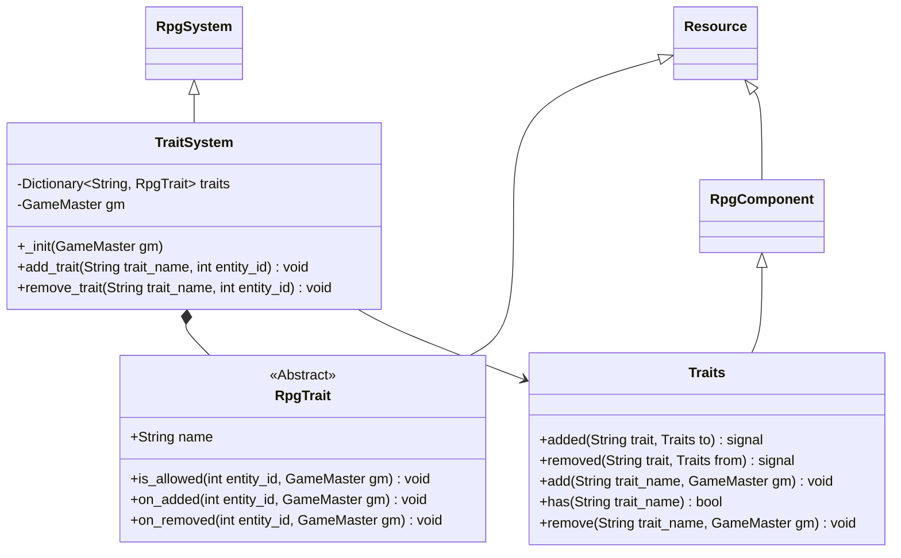

# Game Master Core - Design Document

A framework for developing RPGs, mainly geared towards the Godot 4 engine.

Godot specific terminology:

- `autoload`: merges the singleton and locator patterns.
- `Node`: base class for functional game engine objects.
- `RefCounted`: lightest objects with garbage collection.
- `Resource`: base class for lightweight serializable objects.
- `signal`: a message "emitted" asynchronously by an object, listeners can "connect" to them.

Note that Godot has no concept of `interface` classes, therefore `abstract` is used in places where an `interface` would be a better fit.

## Core Principles

The framework attempts to merge modern programming patters with traditional RPG design concepts.

This is achieved by starting with core RPG mechanics:

- The **Game Master** (GM): a player that controls the game world, adjudicates actions and directs the game's narrative.
- The **Characters**: players or NPCs that take part in the game. They have their own goals, motivations, and behaviors.
- The **World**: an environment where characters interact with.
- The **Mechanics**: a set of rules that govern what happens when characters act.
- The **Character Sheets**: a way to represent character data and the interface between characters and the world.

The key programming patterns used to representing these concepts are:

- **Data-Driven Design** (DDD): using data classes to represent game entities, such as characters, items, and locations.
  `Resource` objects in Godot.
- **Entity-Component-System** (ECS): a pattern for organizing code that represents the behavior of individual components.
- **Command Pattern**: a design pattern for encapsulating actions and logic into commands.

Other programming patterns used based on SOLID principles are:

- **Observer Pattern**: a design pattern that defines a one-to-many dependency between objects so that when one object changes state, all its dependents are notified and updated automatically. `signal` methods in Godot.
- **Strategy Pattern**: a design pattern that enables multiple algorithms, or mechanics, to be chosen at runtime.
- **Dependency Injection** (DI): a technique for providing dependencies to objects without hard coding them into the object's class definition.
- **Builders** and **Factories**: patterns for creating complex objects from simpler ones.

## Architecture

### Core Classes



### Utilities



## Using the Framework

New Systems can be added by connecting to the `GameMaster` signals.

### New Systems and Components

Systems are standalone classes that can manage specific aspects of the game, usually bringing with them new `RpgComponent` objects to implement the desired behavior.

Any object can be a System, and they can connect to the `GameMaster` signals for their specific needs.
Systems can also be based on the `RpgSystem` core base class that provides standard hooks and registration to the `GameMaster`, avoiding boilerplate.

For example, a turn-based RPG may require a `TurnManager` to manage the turn order. This would be a new System that may require a `Initiative` component to track the initiative order.

At initialization, the `TurnManager` would connect to `component_added` and `entity_removed` signals. When a new `Initiative` component is added, the `TurnManager` would add it to the list of managed entities and sort them.

The `TurnManager` would also provide a `turn()` method that would retrieve the next entity in the initiative order and allow it to perform its turn (maybe by retrieving its `Controller` component from the `GameMaster`).

After a turn is over the `TurnManager` could move to the next entity and so on.



### Wrapping existing Nodes

While technically `RpgComponent` could just be an `Object`, it has been preferred to favor wrapping existing nodes in `RpgComponent` objects.
This allows the framework to be more generic and reusable, adding explicit references to an `entity_id`.

For example a `GridEntity` component may wrap a `Node2D` representing a Character or object and include it's position in a grid-based `GameWorld`.



### New Game Worlds

`GameWorld` is just a generic data interface and different gameplay styles or genres may require specific specializations.

For example a grid-based game could use a `TiledWorld` which contains a list of tiles, each containing a list of `GridEntity` objects and dedicated methods for accessing them and calculate their relations.
An old school adventure game could use a `RoomWorld` which contains a list of `Room` of which only one is active at a certain time.

Note how `GameWorld` works, in fact, as a dedicated System, with the only difference that the `GameMaster` manages it "automatically" since an existing World is always necessary.



Continuing the example in the [previous section](#wrapping-existing-nodes), `TiledWorld` would subscribe to the `GridAvatar.moved()` signal to update its content, keeping coupling to a minimum.

### Specialized Entity Containers

The base implementation of `EntityContainer` provides flexibility but may become a bottleneck especially if Entities have many `RpgComponent` objects that are filtered all the time.

In such cases it is encouraged to create a class that inherits from `EntityContainer` that is passed to the `GameMaster`.
This dedicated class can provide caching and offer dedicated methods to access the cached data and lookup specific Components.

## Behavior

### Adding Entities



### Removing Entities



### Perform Actions



The `action_preview signal` can be used by dedicated Systems to modify an `RpgAction` before actual execution.
For example a `CombatSystem` may apply damage reduction based on its own logic, setting a specific value into an `AttackAction`.
It's also fine to implement this kind of logic within the `RpgAction` itself.

## Extensions Examples

### Trait System Example

Example of a full System, used to track status Effects, Skills and other qualities of an Entity.



## Porting to Python

As a personal note, since this framework's architecture is mostly standard OOP and observers, it translates cleanly to other languages, such as Python.
Followgin are a few notes on how to implement it using `dataclasses` and custom `callables`.

### Primitive Mapping

| Godot Primitive | Python Equivalent                   | Architectural Note                                                                  |
| :-------------- | :---------------------------------- | :---------------------------------------------------------------------------------- |
| `Resource`      | `@dataclass`                        | Use `dataclasses.field(default_factory=...)` to handle unique configurations.       |
| `RefCounted`    | Standard Class / `@dataclass`       | Python handles reference counting and garbage collection natively.                  |
| `Node`          | Standard Class                      | Manage structural hierarchies or execution trees manually via lists or composition. |
| `signal`        | Custom `Signal` or `blinker.Signal` | Implements the synchronous Observer pattern.                                        |

### Handling the Observer Pattern (Signals)

Godot's native signaling system can be replaced by an implementation using `Callable`:

```python
from typing import Callable, List, Any

class Signal:
    """A lightweight, synchronous implementation of Godot's signal engine primitive."""
    def __init__(self):
        self._listeners: List[Callable[..., None]] = []

    def connect(self, callback: Callable[..., None]) -> None:
        if callback not in self._listeners:
            self._listeners.append(callback)

    def disconnect(self, callback: Callable[..., None]) -> None:
        if callback in self._listeners:
            self._listeners.remove(callback)

    def emit(self, *args: Any, **kwargs: Any) -> None:
        # Executes synchronously, matching Godot's default signal dispatch behavior
        for callback in self._listeners:
            callback(*args, **kwargs)
```
